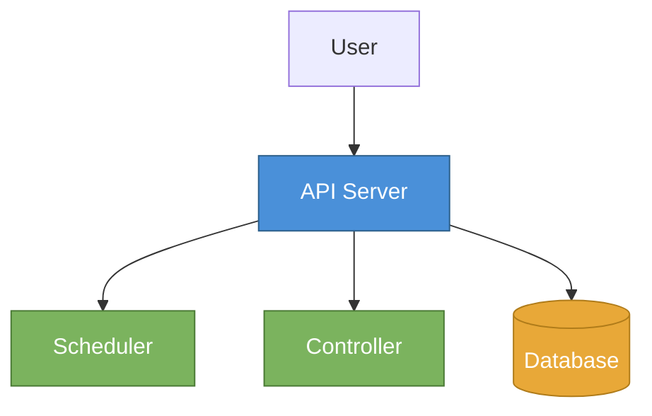

# Diagrams and images

Read this in Step 7, before you make a diagram or any image other than the hero photo.

**Including diagrams and images:** Every article MUST also include at least 1-2 diagrams to illustrate key concepts. Use these approaches:

1. **Mermaid diagrams** (preferred for architecture, flows, sequences, comparisons, tables) — generate a Mermaid `.mmd` file in `.scratch/` at the session base (see the `sadensmol-router` scratch-dir rule), render to PNG using the globally installed `mmdc` CLI, save to `/static/images/posts/`, and reference in the article
2. **Sequence diagrams** — use Mermaid sequence diagrams for request/response flows

**NEVER use ASCII-art tables, boxes, or diagrams in code blocks** (`┌──┬──┐`, `│ │`, `└──┴──┘`, etc.). They look awful in the rendered blog — rows misalign, borders break, monospace rendering varies across devices. If you want to show a table layout, a row/column comparison, or any "boxy" structure — ALWAYS render it as a Mermaid diagram (JPG or PNG) instead. This includes:
- Row-store vs column-store comparisons
- "Before / After" diagrams
- Data layout illustrations
- Any table-like schematic
- Protocol stack layers
- Memory/disk layouts

The only acceptable ASCII in code blocks is actual code, real CLI output, or short directory trees (where monospace alignment naturally works).

**Mermaid rendering command:**
```bash
mmdc -i .scratch/diagram.mmd -o /path/to/static/images/posts/slug-descriptor.png -b transparent -t neutral -s 2
```

**IMPORTANT rendering notes:**
- Use `mmdc` directly (globally installed via `npm install -g @mermaid-js/mermaid-cli`). Do NOT use `npx -y @mermaid-js/mermaid-cli mmdc` — it has argument parsing bugs
- If `mmdc` is not found, install it first: `npm install -g @mermaid-js/mermaid-cli`
- Always use `-b transparent` — the blog CSS auto-inverts only PNG images on dark theme via `filter: invert(0.88) hue-rotate(180deg)` on `img[src$=".png"]`, so transparent backgrounds work on both themes. Hero photos (JPG) are not affected
- Always use `-s 2` for 2x scale — default scale produces tiny, unreadable diagrams on the blog
- Use `-t neutral` for a clean look
- Write `.mmd` files to `.scratch/` at the session base, never into `content/` or `static/`

**Mermaid layout rules (CRITICAL — follow these to avoid unreadable diagrams):**
- **NEVER use nested subgraphs** — they produce scattered, unbalanced layouts that Mermaid's layout engine cannot handle well
- **Use flat flowcharts** with color-coded `style` directives to visually group related nodes instead of subgraphs
- **Color-code by role** — e.g. blue for central components, green for internal services, orange for storage, purple for workers, gray for leaf nodes
- **Keep labels single-line** — NEVER use `\n` in node labels (renders as literal text). Use short, clear labels instead
- **Use `stateDiagram-v2`** for process/lifecycle diagrams instead of flowcharts with diamond decision nodes — state diagrams produce cleaner cycle visualizations
- **Colored diagrams and dark mode:** colored PNGs will look wrong with dark mode CSS inversion. Two options: (1) save as `.jpg` instead of `.png` to skip inversion and keep colors, or (2) use monochrome/gray for diagrams that must be `.png`. Ask the user which they prefer
- Always verify rendered diagrams by reading the PNG before proceeding — if it looks bad, redo it

Example of a clean colored flat flowchart:


Diagram guidelines:
- Save generated images to `/static/images/posts/<slug>-<descriptor>.png` (or `.jpg` for colored diagrams)
- Reference in article as ``
- Place diagrams near the text they illustrate, not all at the top
- Alt text should describe what the diagram shows
- Use diagrams to explain: architecture, data flow, request lifecycle, comparison tables, decision trees
- Always verify rendered PNGs/JPGs by reading them before proceeding
