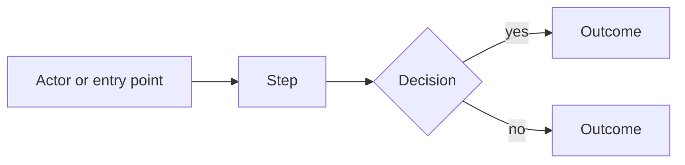
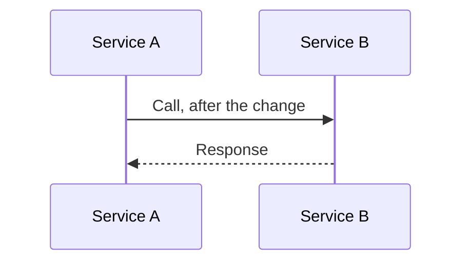

# Plan template

Copy the block below into the plan file and fill it. The rules for each section follow
the block. Keep every `##` heading text exactly; drop an optional `###` sub-section when
it does not apply. Write no table of contents: plannotator builds one from the headings.
Write every item reference as `[ID]` (`see [S3]`), never a bare id or a hand-written
anchor, then run `scripts/plan-links.py <plan> fix` and `check` (`SKILL.md` → *Item links*).

````markdown
# <ISSUE-ID> — <title>

Status: draft · Stage: PLAN · Mode: single | pair · Updated: <YYYY-MM-DD>

## Task

> **In short:** <one line: what changes, for whom, why>

### What and why

<2–5 short sentences: the task in plain words, the business reason, who is affected.>

### Problem facts

| Id | Fact | Value | Source |
|---|---|---|---|
| F1 | Observed | <symptom, exact error text, env, affected entity> | I1 |
| F2 | Expected | <acceptance criteria or exact desired output> | I1 |
| F3 | Where | <repo / service / screen / flow> | <code ref> |
| F4 | Verify by | <steps, request, test or real data> | <source> |

### Sources

| Id | Source | Link / path | What it gives |
|---|---|---|---|
| I1 | Tracker issue | <URL> | title, description, acceptance criteria |
| I2 | Issue comments and attachments | <URL> | <what each one adds; every image read> |
| I3 | Messenger thread | <permalink> | <decision or report it holds> |
| I4 | Docs | <path or URL> | <rule or spec> |
| I5 | Logs / dashboards / queries | <query or panel> | <evidence> |
| I6 | Code | `repo/path:line` | <current behaviour> |
| I7 | User (chat) | <date> | <request, verbatim in Decisions> |

### Done when

- [ ] <observable outcome 1>
- [ ] <observable outcome 2>

### Not requested

<One line per repo, file, status change or default that goes beyond the sources and the
user's words, each waiting for an explicit user yes. `none` when empty.>

## Questions to clarify

> **In short:** <how many questions, and the one with the biggest impact — or "none">

### Q1 — <topic> (<YYYY-MM-DD>, PLAN)

- question: <one concrete question the user can answer in one line>
- options: <O-ids or short options, each with its effect on the plan>
- recommendation: <the option you advise> — <the reason, with ids or `path:line`>
- assumed: <the option this plan is written on>
- affects: <the plan ids that change when the answer differs>
- checked: <the sources read, and any access blocker>
- answer:

## Now

> **In short:** <one line: how it works today and what is wrong>

### How it works now



<2–4 plain sentences that walk the diagram, with no code names. Only when words and the
diagram cannot show the point, add the key code, at most 15 lines:>

`repo/path/file.go:120`
```go
// only the lines that the point needs
```

### The problem

Status: **PROVED** | **NOT REPRODUCED** | **NOT A PROBLEM**

| | Observed | Expected |
|---|---|---|
| Behaviour | <F1> | <F2> |
| Evidence | <log line / failing test / query result / code path> | |

<Why it happens, in 2–4 plain sentences. The code location goes in the Evidence row,
not here. NOT REPRODUCED or NOT A PROBLEM: what was checked and what to do instead.>

### What must change

| Id | Before | After | Where |
|---|---|---|---|
| C1 | <current behaviour> | <target behaviour> | `repo/path` |



## R&D

> **In short:** <one line: the chosen approach and why>

### Measurements

| Id | What | Tool / source | Env | Command / query | Result | Shows |
|---|---|---|---|---|---|---|
| M1 | <latency, error rate, row count, query plan, test time, …> | <metrics, logs, traces, DB, test, benchmark, profiler> | <local / dev / stage / prod> | `<exact command, query or panel>` | <the real number, with unit and time window> | <what it proves for the task> |

### Options

| Id | Option | How | Pros | Cons | Verdict |
|---|---|---|---|---|---|
| O1 | <name> | <one line> | <…> | <…> | **chosen** |
| O2 | <name> | <one line> | <…> | <…> | rejected: <reason> |

### Best practices

- <project rule, doc or convention that applies, with its source>
- <external practice, with a link>

### Risks

| Id | Risk | Impact | Mitigation |
|---|---|---|---|
| K1 | <what can go wrong> | <who or what breaks> | <how the plan avoids it> |

### Related ideas

<Ideas found during R&D that are out of scope. Not plan items. `none` when empty.>

## Plan

> **In short:** <one line: the number of steps, repos and tickets>

### Scope

| Repo | Files / packages | Change |
|---|---|---|
| <repo> | `path/…` | <what changes> |

### Steps

#### S1 — <title>

- **what:** <the change, in plain words>
- **where:** `repo/path:symbol`
- **how:** <the approach, with the option id>
- **check:** <the test, command or observation that proves it>
- **needs:** <ids it depends on, or `—`>

#### S2 — <title>

<same shape>

### Story split

| Id | Ticket title | Steps | Assignee | Estimate | Depends on | Tracker fields |
|---|---|---|---|---|---|---|
| T1 | <title in the tracker's format> | S1, S2 | <person> | <points> | — | <project, labels, parent, cycle> |

### Rollout

<deploy order, config, migration, feature flag, rollback. `none` when a plain merge.>

## Testing

> **In short:** <one line: how many new tests, where, and what guards against regression>

### New behaviour

| Id | What it proves | Type | Where (file / suite) | Covers |
|---|---|---|---|---|
| V1 | <the new or fixed behaviour, with its input and expected result> | <unit / integration / e2e / manual> | `repo/path/x_test.go` → `TestName` | S1, C1 |

### Regression

| Id | Existing behaviour at risk | Guarded by | Run |
|---|---|---|---|
| V2 | <flow or contract the change touches> | <existing test / suite, or a new one> | `<exact command>` |

### Backward compatibility

| Id | Old side | Check | Where |
|---|---|---|---|
| V3 | <old data, old client or API caller, old config, mixed-version deploy> | <what must still work> | <test or step> |

`none — <why>` when the change adds nothing that old data or callers can meet.

### Edge and negative cases

| Id | Case | Expected | Where |
|---|---|---|---|
| V4 | <error path, limit, empty input, retry, concurrency, cancellation> | <result> | <test> |

### Project checks

<The definition-of-done tests the project skill requires (e2e suite, docs check, …), each
with its `V<n>`, suite and env. `none` when the project names none.>

### Test scope

<Targeted runs while working (the `V<n>` ids and their commands); the full suite runs in
CI at finish.>

## Docs

> **In short:** <one line: the docs this change likely touches, or "none" and why>

- `repo/path/doc.md` — <what a reader must learn, in plain words>

## Q&A

none yet

## Decisions

none yet
````

## Section rules

### Task

- **Sources** lists every input read: the whole tracker issue, every comment, every
  attachment and image, linked issues, messenger threads, docs, logs, dashboards, the
  code read, and the user's chat requests. A source not read is not listed.
- **Problem facts** are the four answers of the clarity gate (`sadensmol-task` →
  `references/plan.md`, step 3). A fact you cannot fill does not stop the plan: write
  `unknown — see Q<n>` in its cell and add the question to `## Questions to clarify`.
- **Not requested** needs an explicit user yes per line. A general approval of the plan
  does not cover it.

### Questions to clarify

- Write it last, after `## Testing`, when you know which items each gap affects. It sits
  near the top so the user sees it first.
- Only real questions: a fact no source holds, or a critical choice (`sadensmol-plan` →
  *Questions to clarify*). A noncritical choice is a `D<n>`, never a question.
- Every entry has `recommendation:`, `assumed:` and `affects:`, and every item in
  `affects:` carries `(assumes Q<n>)`.
- `none` when there is no question.

### Now

- A reader who does not know the code must understand this section from its plain
  sentences and diagrams alone (`SKILL.md` → *Write simply*).
- Always at least one diagram. Pick the type by what is hard to see: the flow of a
  decision (`flowchart`), calls between services (`sequenceDiagram`), or a status
  lifecycle (`stateDiagram-v2`).
- **The problem** gets a status with evidence:
  - `PROVED` — reproduced, or shown by a log line, a failing test, a query result or an
    unambiguous code path.
  - `NOT REPRODUCED` — what was tried; the plan then starts with a step that gets the
    missing evidence.
  - `NOT A PROBLEM` — the behaviour is correct; say why. The plan proposes a reply or a
    docs change, not a code change.
- A feature task (nothing is broken) names the gap instead: "today X is not possible".

### R&D

- **Measurements (MUST FOLLOW)** — every real measurement that bears on the task:
  platform data (metrics, logs, traces, DB row counts and query plans, dashboards) and
  test data (existing tests, benchmarks, load or profiling tools, run unchanged). Take
  the tools and their access rules from the project skill. Use every source that
  applies, not only one.
  - A row holds a real, measured value, with its unit, env and time window. An estimate
    or an expectation is not a measurement: it goes to `### Risks` or `## Q&A`.
  - Every row has the exact command, query or panel, so anyone can repeat it.
  - Measure before and, when the plan changes performance or volume, state the target
    value the `check` of a step will measure after.
  - A measurement that matters but cannot be taken: one row with `Result: blocked —
    <the specific blocker>`.
  - Nothing measurable applies (a pure config or docs task): one line, `none — <why>`.
  - In a task, a test or benchmark run is a session branch (`sadensmol-task` → *Session
    branches*). Measuring is read-only: no edit, no deploy, no write to a shared env.
- At least two options when a real choice exists. A single obvious path gets one row and
  the reason there is no alternative.
- Every chosen option that neither the sources nor the user settled is also a `D<n>`
  entry in `## Decisions`.
- **Best practices** cites the project's own rules first (project skill, docs, repo
  `CLAUDE.md`), then general ones.

### Plan

- Steps are in execution order. Each one is small enough to review in one sitting.
- **check** is concrete: a test name or package, a command, a request and its expected
  response. "Works" is not a check.
- **Story split** is only for story planning (a parent ticket split into children). Take
  the ticket fields from the project's tracker skill (`<project>-linear`,
  `sadensmol-jira`, …): title format, assignee, estimate scale and minimum, labels,
  project, parent, cycle. A value the rules and the user do not give → ask, never guess.
  Do not create the tickets during PLAN; the plan lists them, and the tickets are created
  after the approval.
- Each step's **check** names the `V<n>` ids from `## Testing` that prove it.

### Testing (MUST FOLLOW)

- Every plan has `## Testing`, also a fix or a small change. A docs- or config-only task
  states `none — <why>` per sub-section, never drops the section.
- **New behaviour**: every `C<n>` and every code step `S<n>` is covered by at least one
  `V<n>`. "Where" is the exact file and test name (new or extended), read from the repo's
  existing tests: extend the existing suite or parameterized list before writing a new
  one. A bug fix gets a test that fails before the fix and passes after.
- **Regression**: list the existing tests and flows that touch the changed code (callers,
  shared helpers, contracts), with the command that runs them.
- **Backward compatibility**: check every old side the change can meet — stored data
  written before it, old clients and API callers, old config, and old and new versions
  running at once during a deploy. What only this task added has no old data
  (`sadensmol-programming` → *Backward-Compatible Data*).
- **Project checks**: take the required tests and suites from the project skill (its task
  skill's definition of done). Do not invent them.
- **Test scope** follows the task test scope (`sadensmol-task` → *Test scope*): targeted
  tests while working, the full suite in CI at `finish`.

### Docs (MUST FOLLOW)

- Every plan has `## Docs`, written last, after `## Testing`: a few hint bullets, or
  `none — <why>`. Spend little effort here: a quick search of the docs for the changed
  behaviour, no ids, no table.
- The hints are not `S<n>` steps and not a gate. The final list comes from the final diff,
  once, after the last code change and before the merge (`sadensmol-task` →
  `references/finish.md` → §6a).

### Logs

The two log sections keep `none yet` until the first entry. The first `pair.py` write
appends below it; the planner removes the `none yet` line on its next rework.

A `## Decisions` entry uses the formats of `sadensmol-plan` → *The logs*: every entry has
`decided:` and `done:`, never only the user's words.

`## Q&A` holds only answered questions. An open question goes to
`## Questions to clarify`, never here.
